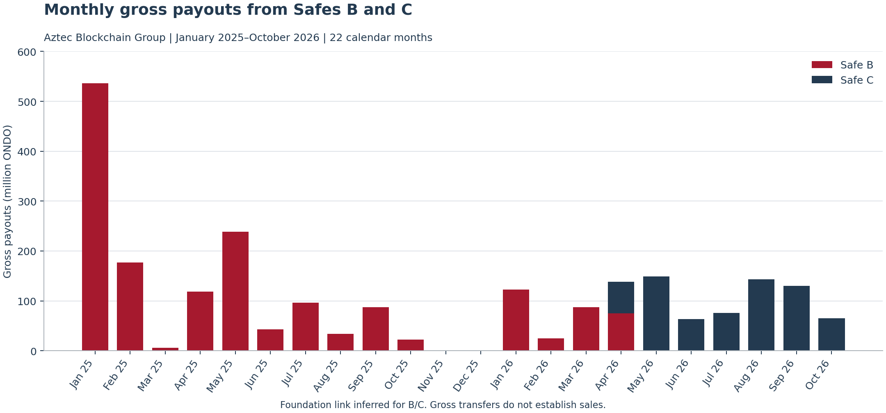
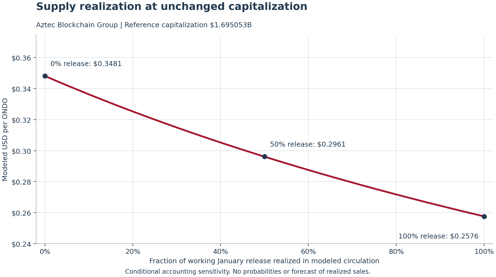

# ABG ONDO Research

**Aztec Blockchain Group at San Diego State University**  
**Franklin Templeton Crypto Research Competition 2026**

Reproducible research supporting ABG's conditional ONDO short thesis. The analysis connects tokenholder economics, observed inventory distribution and January 2027 scheduled availability. It does not establish that transfers are sales or that scheduled supply forces a particular market price.

Research cutoff: November 8, 2026 Pacific. Historical evidence checks reported in the source set were performed November 9. The repository runs offline with included numerical evidence and explicit working assumptions.

## Research overview

ONDO provides governance over the Ondo DAO and Flux Finance. Product adoption and Foundation commercial assets create possible future benefits, but the supplied evidence does not establish an automatic commercial-income pass-through to ONDO holders. The report proposes staged short exposure conditional on new supply delivery and weak absorption. Stronger demand, funded holder benefits or delayed delivery can overturn that premise.

Our original investigation follows ONDO payouts from two Safes linked to the officially disclosed Foundation wallet by funding and activity. It measures gross movement, not beneficial ownership, selling or net free float. Scenario prices then separate assumed circulating-supply realization from assumed capitalization.

## Reproduced findings

| Measure | Calculated result |
| --- | ---: |
| Transfer rows / unique transaction hashes | 203 / 202 |
| Unique recipients | 166 |
| Gross B/C payouts | 2,357,719,599.756896 ONDO |
| 2025 payouts | 1,359,038,783.067002 ONDO |
| January–October 2026 payouts | 998,680,816.689894 ONDO |
| Calendar-month average across 22 months | 107.169073M ONDO |
| Working January 2027 release | 1,710,101,379.64 ONDO |
| Flat-cap price at 0% / 50% / 100% realization | $0.3481 / $0.2961 / $0.2576 |

One C transaction contains two payouts to different recipients. Four rows are zero at exported precision; they remain in the published row count. November and December 2025 have zero payouts. Comparable January–October payouts declined in 2026, and the two saved anniversary windows show slight ONDO outperformance versus BTC. These are counterevidence to claims of accelerating payouts or a dependable unlock crash.





## Original methodology

1. Verify evidence checksums and load the supplied transaction-level numerical fields using exact decimal arithmetic.
2. Distinguish official Safe A attribution from inferred B/C links. Recalculate selected A funding subtotals.
3. Aggregate transfers by UTC calendar month and Safe, retaining all 22 months.
4. Calculate the working unlock from published allocations and a five-step convention; retain the four-step alternative.
5. Evaluate `price = capitalization / (reference circulation + release × realization)` and the report's Appendix B capitalization grid.
6. Recompute historical counterevidence from saved Coinbase candles and run automated report reconciliation checks.

See [METHODOLOGY.md](METHODOLOGY.md) for assumptions and [data/README.md](data/README.md) for evidence provenance and redistribution review.

## Repository structure

```text
README.md                         Overview and reproduction instructions
METHODOLOGY.md                    Definitions, formulas and evidence limits
VERIFICATION.md                   Validation results and unresolved issues
requirements.txt                 Direct Python dependencies
requirements-lock.txt            Complete tested environment
data/                            Selected numeric evidence, assumptions and outputs
notebooks/ONDO_Analysis.ipynb      Executed analysis with explanation and figures
scripts/analysis.py               Shared calculations and chart generation
scripts/verify.py                 Automated report reconciliation checks
scripts/run_notebook.py           Notebook execution with the active interpreter
figures/                         Generated PNG and SVG exhibits
```

## Reproduce the analysis

Tested with Python 3.13.6 on Windows. From the repository root, PowerShell:

```powershell
python -m venv .venv
.\.venv\Scripts\python -m pip install -r requirements.txt
.\.venv\Scripts\python scripts/verify.py
.\.venv\Scripts\python scripts/run_notebook.py
```

On macOS/Linux, use `.venv/bin/python` in place of `.\.venv\Scripts\python`. Use `requirements-lock.txt` instead of `requirements.txt` to install the exact tested transitive versions. The lock records a Windows environment; other operating systems were not tested.

The runner executes every cell using the current Python interpreter, updates the notebook outputs and regenerates both figures, `data/monthly_gross_payouts.csv` and `data/calculated_results.json`. It needs no registered global kernel, API key or Downloads folder. View the executed notebook in GitHub or a Jupyter-capable editor. A Jupyter browser server is optional and not required by the runner.

For calculations and figures without executing Jupyter:

```powershell
.\.venv\Scripts\python scripts/analysis.py
```

## Research limitations

- The original later CoinGecko response is absent. The reported $1,695,052,960 capitalization and 4,869,330,647 circulation form a qualified working reference. Their implied $0.348108 price differs from the reported $0.348318 quote by about 0.0603%.
- Only Safe A is officially attributed in the source set. B/C attribution is inferred; the supplied selected funding records are not a complete balance ledger.
- The selected A-to-B large-transfer export sums to 1,548,558,412 ONDO, **100 ONDO below** the report/memo funding claim. Smaller-transfer coverage is a possible explanation, but the missing record is not supplied. No data is altered to close the gap.
- The source memo reports independent historical chain matching. This repository reproduces export arithmetic and checks integrity; complete underlying explorer histories, raw token units, blocks and log indices were not provided for a fresh offline audit.
- Beneficiary-specific vesting terms and the January 17/18 epoch remain unresolved. The 1.710101B working estimate is not a guaranteed circulation increase.
- Missing recipient histories and dated labels prevent reproducible downstream exchange allocation. Those columns and unsupported insider-selling estimates are excluded.
- Scenarios are conditional identities, not intrinsic values, probabilities or cost-adjusted trade returns. Historical payouts are not an additional independent unlock tranche.

## Sources

- [ONDO token documentation](https://docs.ondo.foundation/ondo-token), [Foundation unlock proposal](https://blog.ondo.foundation/unlocking-ondo-a-proposal-from-the-ondo-foundation/) and [FIP 08](https://forum.fluxfinance.com/t/fip-08-release-of-the-ondo-token-lock-up/563).
- [Official Foundation wallet disclosure](https://blog.ondo.foundation/ondo-foundation-group-wallet-address-disclosure/) and [Ethereum ONDO contract](https://eth.blockscout.com/token/0xfAbA6f8e4a5E8Ab82F62fe7C39859FA577269BE3).
- [Ondo Stocks legal documentation](https://docs.ondo.finance/ondo-stocks/legal-and-regulatory) and [Ondo DAO documentation](https://docs.ondo.foundation/ondo-dao).
- Public Coinbase candles in the supplied original archive; [candle methodology](https://docs.cdp.coinbase.com/exchange/reference/exchangerestapi_getproductcandles).
- ABG's supplied report, reconciliation package and evidence-decision memo. Only selected numerical records are included; their source hashes are recorded in [data/provenance.json](data/provenance.json). A source memo's verification claim is not treated as independent proof by this build.

The organization is inspired by the university research purpose of [MBC Research](https://github.com/frank22lin/MBC-Research). No code or data was copied from that repository.

## Publish after review

The local repository points to `https://github.com/bavi19/ABG-ONDO-Research.git`. After reviewing the data notes and outputs, publish changes with:

```powershell
git status --short
git add README.md METHODOLOGY.md VERIFICATION.md requirements.txt requirements-lock.txt .gitignore data notebooks scripts figures
git diff --cached --stat
git diff --cached
git commit -m "Add reproducible ONDO research analysis"
git push -u origin main
```

Review the staged files before committing. Raw archives, local review notes, credentials and environments are excluded. No license grant for third-party material is implied; see the data review before public release.
